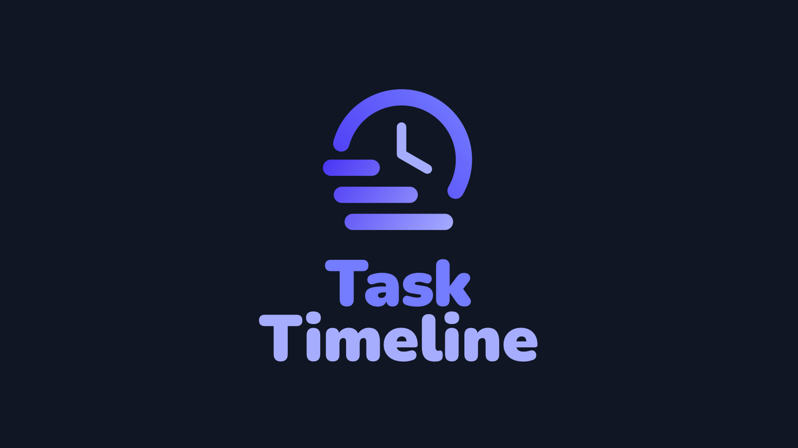

# Task Timeline



Visualise scheduled tasks on a timeline inside Jellyfin's administration dashboard.

The plugin provides an administrator-only seven-day forecast API with daily/weekly projections, explicit timing uncertainty and read-only overlap indicators. Native live-progress transport is verified through a development diagnostic. The timeline UI is not implemented yet. The first functional release will be read-only; editing and restore are later work.

## Requirements

- Jellyfin 12.2 (target ABI `12.2.0.0`). Runtime compatibility must be verified on Jellytest before release.
- .NET 10 SDK for development.
- Node.js 24 for live-task lifecycle tests.
- Python 3.10 or newer for packaging checks (standard library only).

## Build and check

```sh
dotnet restore Jellyfin.Plugin.TaskTimeline.sln
dotnet format Jellyfin.Plugin.TaskTimeline.sln --no-restore --verify-no-changes
dotnet build Jellyfin.Plugin.TaskTimeline.sln --configuration Release --no-restore
dotnet test Jellyfin.Plugin.TaskTimeline.sln --configuration Release --no-build
node --test tests/web/*.test.mjs
python3 -m unittest discover -s tests/packaging -v
```

## Install and update

<!-- TODO: point this at https://raw.githubusercontent.com/traejiik/jellyfin-tjk-plugins/main/manifest.json, which lists every version of both plugins. -->
Once the first public release exists, add this repository URL in Jellyfin's plugin repository settings:

```text
https://github.com/traejiik/jellyfin-tasktimeline/releases/latest/download/manifest.json
```

Install **Task Timeline** from the catalog and restart Jellyfin as required. Later stable releases update the same feed URL. Until a first release exists, this URL will return 404.

The root `manifest.json` is a template, not a live installation feed. Its `versions` list starts empty. A release adds the tag-derived version, target ABI from the Jellyfin.Controller package reference, timestamp, download URL and checksum to the generated manifest, and uses the catalog artwork URL. The generated feed contains the latest release only; older packages remain on GitHub Releases.

For the development-only live-progress probe, see [diagnostics](docs/diagnostics.md).

See [architecture](docs/architecture.md), [operations and releases](docs/operations.md), and [product scope](docs/product.md).
